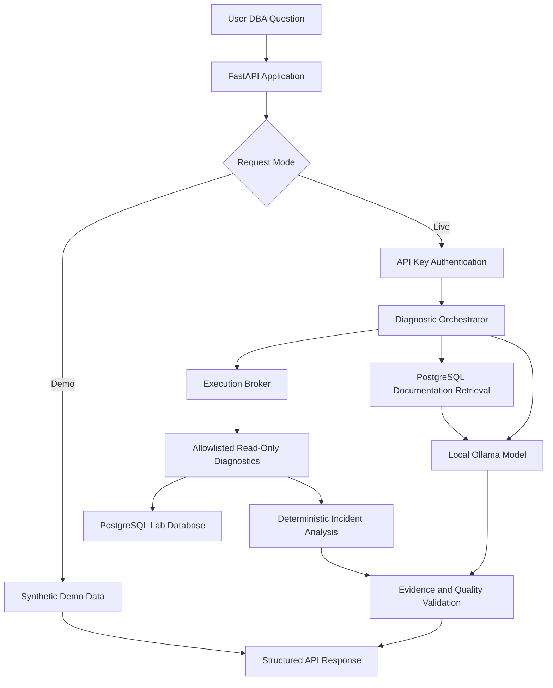

# AI-Powered PostgreSQL DBA Incident Management Platform

**An evidence-driven PostgreSQL DBA platform for database diagnostics, incident analysis, and operational troubleshooting.**

Developed and maintained by **Rohan Joardar**.

---

## Overview

The PostgreSQL DBA Incident Management Platform combines deterministic database diagnostics, incident correlation, PostgreSQL documentation retrieval, and AI-assisted analysis.

It is designed to help database administrators investigate common PostgreSQL operational issues, understand diagnostic evidence, identify potential causes, and evaluate safe remediation options.

The platform emphasizes evidence-based conclusions and human-reviewed recommendations rather than autonomous database modifications.

## Key Features

### 1. PostgreSQL diagnostics

The diagnostic toolkit supports:

- Database health checks
- Connection monitoring
- Transaction analysis
- Lock and blocking investigation
- Table statistics
- Index statistics
- Replication diagnostics
- Configuration inspection
- Query statistics

### 2. Incident analysis

Deterministic analysis components evaluate:

- Connection pressure and utilization
- Long-running transactions
- Idle-in-transaction sessions
- Long-running queries
- Blocking relationships
- Correlated database incidents

Incident severity and recommendations are derived from collected evidence.

### 3. AI-assisted DBA analysis

The orchestration layer combines:

- Live diagnostic evidence
- PostgreSQL documentation retrieval
- Local Ollama model analysis
- Evidence validation
- Response quality checks

The AI provides explanations and recommendations. It does not independently execute generated SQL or apply database changes.

### 4. SQL validation

The SQL validation module uses SQLGlot with PostgreSQL dialect parsing to validate proposed SQL structure and apply policy checks.

PostgreSQL remains the authoritative source for actual SQL compatibility and execution behavior.

### 5. Secure execution broker

The execution broker enforces a restricted database connection target and an allowlist of supported diagnostic operations.

Its controls include:

- Restricted database and monitoring role
- Local database connection target validation
- Diagnostic allowlisting
- Read-only diagnostic collection
- Execution timeouts inherited from the toolkit
- Private execution audit records

### 6. API

The FastAPI application exposes health, service status, synthetic demo diagnosis, and authenticated live diagnosis endpoints.

---

## Architecture



The public demo path uses synthetic data. The live path is intended for a separately configured private environment.

## Technology Stack

| Component | Technology |
|---|---|
| Database | PostgreSQL |
| Backend API | Python, FastAPI |
| Database connectivity | Psycopg 3 |
| SQL parsing | SQLGlot |
| AI inference | Ollama |
| AI model | Qwen 3.5 4B |
| Documentation retrieval | Python-based ingestion and retrieval |
| Data validation | Custom evidence and quality validators |
| Testing | Pytest |
| Development environment | Windows 11, WSL2, Ubuntu |

## Project Structure

```text
postgres-dba-agent/
│
├── agents/
│   ├── diagnostics/
│   │   ├── connection_pressure.py
│   │   ├── transaction_lock_analyzer.py
│   │   └── incident_correlator.py
│   │
│   ├── quality/
│   ├── sql_validation/
│   ├── execution_broker.py
│   └── orchestrator.py
│
├── api/
│   ├── main.py
│   ├── config.py
│   ├── schemas.py
│   └── routes/
│       ├── health.py
│       └── diagnosis.py
│
├── knowledge_ingestion/
│   ├── crawler/
│   ├── normalization/
│   ├── chunking/
│   └── embeddings/
│
├── skills/
│   └── postgres-patterns/
│
├── tests/
│   ├── diagnostics/
│   ├── quality/
│   ├── sql_validation/
│   └── test_execution_broker.py
│
├── tools/
│   ├── postgres_dba_toolkit/
│   └── postgres_dba_toolkit_v2/
│
├── COPYRIGHT.md
├── LICENSE
└── THIRD_PARTY_NOTICES.md
```

## Running the Synthetic Demo API

The demo endpoint uses synthetic sample metrics. It does not connect to PostgreSQL, execute SQL, or require Ollama.

### Requirements

- Python 3.10 or later
- pip

### 1. Clone the repository

```bash
git clone https://github.com/joardarrohan97/postgres-dba-agent.git
cd postgres-dba-agent
```

### 2. Create a virtual environment

```bash
python3 -m venv .venv
source .venv/bin/activate
```

### 3. Install the API dependencies

```bash
python -m pip install --upgrade pip
python -m pip install fastapi uvicorn python-dotenv
```

### 4. Start the API

```bash
uvicorn api.main:app --host 127.0.0.1 --port 8000
```

### 5. Open the API documentation

Visit:

- API documentation: http://127.0.0.1:8000/docs
- Health endpoint: http://127.0.0.1:8000/health
- Service status: http://127.0.0.1:8000/api/v1/status

### 6. Try the demo diagnosis

```bash
curl -X POST http://127.0.0.1:8000/api/v1/demo/diagnosis \
  -H "Content-Type: application/json" \
  -d '{"question":"Why is PostgreSQL experiencing high connection usage?"}'
```

The response contains synthetic metrics and explicitly identifies that no database was accessed and no SQL was executed.

---

## API Endpoints

| Method | Endpoint | Purpose |
|---|---|---|
| GET | `/` | Application information |
| GET | `/health` | Health check |
| GET | `/api/v1/status` | Service configuration status |
| POST | `/api/v1/demo/diagnosis` | Synthetic demonstration |
| POST | `/api/v1/diagnosis` | Authenticated live diagnosis |

### Live diagnosis security

The live endpoint requires:

- Explicit live API mode configuration
- A configured API key
- An `X-API-Key` request header
- A separately configured private database and Ollama environment

The live endpoint is not a public database service.

## Security and Safety

The platform follows an evidence-first and read-only diagnostic approach.

- No automatic database remediation.
- No automatic session termination.
- No unrestricted SQL execution.
- No automatic configuration changes.
- Restricted diagnostic execution through an allowlisted broker.
- API-key authentication for live diagnosis.
- Private audit records for diagnostic execution.
- Human review required before applying proposed remediation.

**Important:** The synthetic demo endpoint does not represent live database health or actual production metrics.

Never commit database credentials, API keys, `.env` files, private logs, or database connection strings.

Do not expose the private backend, PostgreSQL instance, or Ollama service directly to the public internet.

## Testing

The local diagnostic, quality, execution broker, and SQL validation test suites have been run successfully.

Command:

```bash
pytest -q tests/diagnostics tests/quality tests/test_execution_broker.py tests/sql_validation
```

Latest recorded local result: **85 tests passed**.

## Current Scope and Development Status

The repository contains the foundational diagnostic agents, API, execution broker, SQL validation, knowledge ingestion components, and existing PostgreSQL DBA toolkit integration.

Further development areas include:

- Expanded incident coverage
- Automated CI testing
- Improved documentation and demonstrations
- Public portfolio interface
- Additional diagnostic scenarios
- Broader integration and deployment testing

## Project Ownership

**Created and maintained by Rohan Joardar.**

This project is distributed under the proprietary terms described in `LICENSE` and `COPYRIGHT.md`.

Third-party component acknowledgements are documented in `THIRD_PARTY_NOTICES.md`.

---

**Repository:** https://github.com/joardarrohan97/postgres-dba-agent

